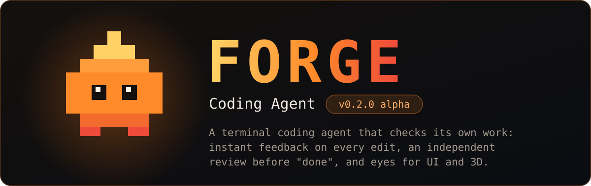
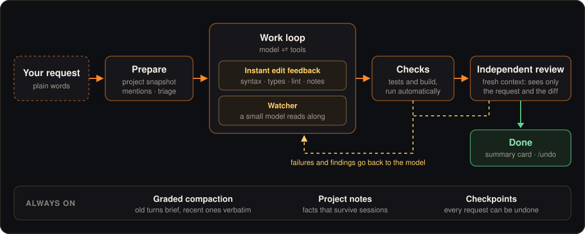

<p align="center">
  
</p>

<p align="center">
  
  
  
  
  
</p>

<h3 align="center">A terminal coding agent that does not take its own word for it.</h3>

<p align="center">
  Forge wraps a model in layers that catch mistakes while they are cheap:<br>
  feedback on every edit, a second pair of eyes before "done", and tools that let it <i>see</i> what it built.
</p>

<p align="center">
  <a href="#quick-start"><b>Quick start</b></a> ·
  <a href="https://cosmic-game-studios.github.io/forge/demo/earth/earth.html"><b>Live demo</b></a> ·
  <a href="#how-it-works"><b>How it works</b></a> ·
  <a href="#models-working-together-pair-mode-and-the-advisor"><b>Pair mode</b></a> ·
  <a href="#what-makes-forge-different-from-claude-code-and-codex"><b>vs. Claude Code and Codex</b></a> ·
  <a href="#what-has-been-measured"><b>Measurements</b></a> ·
  <a href="#where-forge-is-going"><b>Roadmap</b></a>
</p>

<p align="center">
  
</p>

<table>
  <tr>
    <td width="33%" valign="top"><h4>🔍 Caught at the edit</h4>Every write comes back with its syntax, type and lint errors and with plain quality notes. The model fixes a mistake in the step where it made it.</td>
    <td width="33%" valign="top"><h4>🧑‍⚖️ Reviewed by a stranger</h4>Before "done", a second run with an empty context reads only your request and the diff, and tries to break the change.</td>
    <td width="33%" valign="top"><h4>👁️ Eyes for UI and 3D</h4>Screenshots with the page's errors, and a live three.js scene read as numbers and four views. No guessing what the result looks like.</td>
  </tr>
  <tr>
    <td valign="top"><h4>🤝 Two models, one task</h4>Pair mode lets any two different models — also across providers — discuss the approach, split the work and code together. Anthropic, OpenRouter and OpenAI keys work.</td>
    <td valign="top"><h4>↩️ Nothing is final</h4>Every request is a checkpoint. <code>/undo</code> takes its file changes back, and a card shows what changed and what was verified.</td>
    <td valign="top"><h4>🪶 Small enough to read</h4>About 40 source files, one runtime dependency, 65 tests. Every layer is a switch you can turn off and measure.</td>
  </tr>
</table>

## Demo: an Earth built by Forge

<p align="center">
  <a href="https://cosmic-game-studios.github.io/forge/demo/earth/earth.html"></a>
</p>

An interactive 3D Earth with day and night sides, city lights, clouds, an atmosphere shader and bloom — built by Forge from a chat request. The picture above was taken by Forge's own `screenshot` tool. While building, the agent checked the scene with `scene3d`, and the independent reviewer caught black streaks on steep mountain slopes before the agent called it done.

**[▶ Open the live demo](https://cosmic-game-studios.github.io/forge/demo/earth/earth.html)** — drag to rotate, scroll to zoom, space to pause. Code and tests: [`demo/earth`](demo/earth).

## How it works

Most agents are a loop around a model: prompt, tool call, repeat. The model writes code, says it is done, and you find out later whether that was true. Forge puts a harness around the same loop so that a mistake is caught at the step where it happens.

<p align="center">
  
</p>

| Layer | What it does |
|---|---|
| **Request preparation** | Before the model starts, Forge takes a snapshot of the project, finds the files and symbols your request mentions, and has the cheapest model classify the task. The model starts oriented instead of exploring. |
| **Instant edit feedback** | Every write and edit comes back with what is wrong in it: syntax errors, TypeScript type errors (also in other files the edit broke), the project's own linter, and language-independent notes such as placeholders, leftover debug output, swallowed errors, duplicated blocks and merge-conflict markers. |
| **Watcher** | While the main model keeps working, a small model reads each burst of edits and flags problems. It never blocks; its findings arrive with the next step. |
| **Automatic checks** | After changes Forge runs the project's tests or build on its own. Failures go back to the model before it may finish. |
| **Independent review** | Larger changes are read by a second run with an empty context that sees only your request and the diff. It has read-only tools, tries to break the change, and hands its findings back once. |
| **Graded compaction** | When the context fills up, the cheapest model summarises it: old turns briefly, recent ones in detail, the newest word for word. |
| **Memory and undo** | Project notes survive between sessions. Every request is a checkpoint; `/undo` takes its file changes back. |

## What makes Forge different from Claude Code and Codex

Claude Code and Codex are excellent, mature products from the companies that make the models. They have far more polish, sandboxing, IDE integrations and users than a young alpha. Forge does not try to copy them. It makes a different bet:

> **The next jump in coding agents comes less from a smarter model and more from a harness that refuses to trust the model's own "done".**

| | Forge | Claude Code / Codex |
|---|---|---|
| **Checking the work** | Built into the loop and on by default: every edit is answered with type, lint and quality feedback; a second model reads along; a reviewer with a fresh context must pass larger changes before the turn ends. | The model largely decides when and how to verify. Review, hooks and checks exist, but you invoke or configure them. |
| **Who reviews** | A separate run that never saw the author's reasoning, only your request and the diff, so it cannot be talked into the author's blind spots. | Review is typically a command you run, or the same conversation looking at its own work. |
| **Seeing the result** | Ships with eyes: `screenshot` returns the picture plus the page's errors, and `scene3d` reads a live three.js scene as numbers and four views. | General-purpose tools; visual and 3D inspection come through extensions you add. |
| **Models** | One harness for Anthropic, OpenRouter and OpenAI-compatible keys. The cheapest model you have does the side jobs (triage, watching, compaction). Pair mode lets two different models, even from different vendors, plan and code a change together; the advisor lets a cheap model ask an expensive one. | Each is built around its maker's models and subscription. |
| **Size** | About 40 source files, one runtime dependency, strict TypeScript. Small enough to read in an afternoon and change in an evening. | Large products; you configure them rather than rewrite them. |
| **Every layer is a switch** | `/review`, `/watch`, `/autocheck`, `/prepare` turn each layer on or off, and the repository includes the benchmark that measures what each one buys. | Tuned as a whole by the vendor. |
| **Honesty about results** | The README states what was measured, including where Forge is not ahead. | — |

Where they are clearly ahead today: sandboxed execution, IDE and cloud integrations, team features, and years of hardening. If you need those, use them. If you want an agent whose every decision you can read, measure and change, that is what Forge is for.

<sub>Comparison as of November 2026 and to the best of our knowledge; both products move fast. Corrections are welcome.</sub>

## Models working together: pair mode and the advisor

Forge can put more than one model on a request. There are two ways, and they solve different problems. Both are **off by default** and both cost extra, so you switch them on deliberately.

### Pair mode: two models, one task, the whole time

`/pair` picks a second model that works on **every request together with the main model, as equals**. The two must be different models; they can come from different providers, for example Claude Opus 5.5 with an OpenAI model, or Claude Haiku 5.5 with Claude Fable 5.2.

How a request runs in pair mode:

1. **Both propose.** Each model gets the task and the project context and writes its own approach — files, risks, how to verify — without seeing the other's.
2. **They argue it out.** Each reads the other's proposal and says honestly where the other is right and where it is wrong, then states the approach it now recommends. When both answer `AGREE`, the discussion ends early; otherwise it runs for the configured number of rounds (`pairRounds`, default 1).
3. **They agree on a plan and split the work.** The lead (your main model) writes the plan both follow: the approach, what the lead does, what the partner does, and the shared interfaces. No file belongs to both.
4. **They code at the same time.** The partner runs as a background agent on its own model with full tools; the lead works on its part in the foreground. They message each other the whole way through: "the interface is done", a question instead of a guess, a problem spotted in the other's part.
5. **They check each other.** When its part is done, each side reviews the other's work as agreed. The request ends only when both parts are done and fit together.

You watch it live: the discussion appears as `⇄ Opus 5.5 proposes …`, the partner's steps as `◇ Opus 5.5 ● Write file …`, and messages between them as `✉ Haiku 5.5 → Opus 5.5`.

**Why it helps**

- **Two first drafts beat one.** Different models have different blind spots and habits. When both propose independently before seeing each other, the weaker idea gets caught before any code exists — the cheapest moment to fix a design mistake.
- **Disagreement is forced into the open.** Each side has to say where the other is right. A single model talking to itself rarely argues with its own first idea.
- **Faster on work that splits.** Two parts are written in parallel, by two agents that know the plan and each other's interfaces.
- **Built-in cross-checking.** The author of a part is never its only reader.

**What makes it special**

- **Any two models, across providers.** Most multi-model setups pair a model with a copy of itself or stay inside one vendor. Forge lets a Claude model and an OpenAI model plan and code the same change.
- **Peers, not a boss and a helper.** Both propose, both critique, both write code, both review. The lead only breaks ties and writes down the plan.
- **They keep talking while they work**, through the same message system Forge's sub-agents use, instead of meeting once and then working blind.

**Cost.** Pair mode costs both models' work on every request — the discussion plus a second agent coding. How much depends on the pair you choose: Haiku + Sonnet is cheap, Opus + Fable is not. It has not been benchmarked yet, so whether it is worth the price for your tasks is something to try, not a promise.

### The advisor: a cheap model that may ask an expensive one

`/advisor` lets the working model — say Claude Haiku 5.5 — ask a much stronger model such as Claude Fable 5.2 for advice when it is stuck on a hard problem. The advisor gets the question and a condensed transcript, answers once, and has no tools. The working model stays in charge and decides what to do with the advice. It may ask at most a few times per request (`advisorLimit`, default 3). The picker only offers models stronger than the one working and marks them **VERY EXPENSIVE**, with their price.

### Pair mode or advisor?

| | Advisor | Pair mode |
|---|---|---|
| **Idea** | A cheap model works; an expensive one is asked when it gets hard | Two different models work together as equals |
| **When the second model is involved** | Only when the working model asks — often never | On every request, from the first step to the last |
| **What the second model does** | Gives one answer: no tools, no code | Proposes, argues, writes code, reviews |
| **Who decides** | The working model alone | Both agree on the plan |
| **Cost** | Low most of the time; one expensive answer when asked | Both models' full work on every request |
| **Good for** | Saving money: a cheap model for routine work, with a safety net for the hard parts | Quality and speed on larger tasks where two perspectives and parallel work pay off |

In one line: **the advisor is a phone call to an expert; pair mode is a second engineer at the desk.**

## Background work and sub-agents that talk

- **Background processes.** The shell tool can start dev servers, watchers and long builds in the background. The agent gets a job id, keeps working, and reads the output or stops the job later with the `jobs` tool. `/jobs` shows them; running jobs appear above the input box.
- **Sub-agents on demand.** The `task` tool hands a self-contained piece of work to a sub-agent, in the foreground or in the background. Several can run at once, and their reports come back to the main agent when they finish.
- **A team that talks.** Every agent has a mailbox. Sub-agents can message the main agent and each other, ask a question and wait for the answer, and post to `all` — those messages also go to a shared board that every new sub-agent reads first, so context found once is not searched for again.

## Tools that let the model see

- **`scene3d`** — opens a page in a headless browser and reads the real three.js scene: every object with position, size, distance from the camera and whether the camera sees it, plus pictures from the camera, from above, from the front and from the side. The model can press keys and compare positions before and after. Works on unmodified pages.
- **`screenshot`** — renders a URL or a local file at desktop or phone size and returns the picture together with the errors the page reported.
- **`deps`** — the import graph: what depends on a file, and which tests reach it.
- **`outline`**, **symbol edits** — read a file's structure and replace a whole function by name instead of matching text.
- **`check`** — runs the project's checks, or only the tests affected by what changed.
- **`task`**, **`jobs`**, **`message`** — sub-agents, background work and messages between agents (see above).
- **MCP** — connect any [Model Context Protocol](https://modelcontextprotocol.io) server through `~/.forge/mcp.json` or a project's `.mcp.json` (project servers start only after you approve them).
- **Skills** — instructions loaded on demand. Built in: `frontend-design` and `3d-worlds`. Add your own as `SKILL.md` files.

## Quick start

Requires Node.js 22.6 or newer (24 recommended).

```bash
git clone https://github.com/Cosmic-Game-studios/forge.git
cd forge
npm install
npm run build
npm link
```

Then, in any project folder:

```bash
forge
```

On first start type `/keys` and paste your API key. Forge stores it in `~/.forge/config.json` on your machine, never in the project. You can also set `ANTHROPIC_API_KEY`.

### Providers

Forge speaks to **Anthropic**, **OpenRouter** and **OpenAI-compatible** endpoints. It is tuned for Claude models (Fable 5.2, Opus 5.5, Sonnet 5.5, Haiku 5.5) with adaptive thinking, prompt caching and streamed tool inputs.

```bash
forge -m anthropic:claude-opus-5-5
forge -m openrouter:anthropic/claude-opus-5.5 -e xhigh
forge -p "explain what src/agent.ts does"          # headless, read-only
forge -p "fix the failing test" --mode auto-edit   # headless, may edit
```

## Commands

<details>
<summary><b>All slash commands</b></summary>
<br>

| | |
|---|---|
| `/model` `/effort` `/subagent` | choose the model, how hard it thinks, and the model for sub-agents |
| `/pair` | a second, different model works on every request together with the main one (off by default, expensive) |
| `/advisor` | let the working model ask a stronger one on hard problems (off by default, very expensive) |
| `/jobs` | background processes and sub-agents: list, read, stop |
| `/history` `/view` | the full conversation; how many recent requests stay on screen (default 5) |
| `/mode` | `ask`, `auto-edit` or `yolo` (shift+tab cycles) |
| `/undo` | take back the file changes of the last request |
| `/compact` `/new` `/resume` | manage the conversation |
| `/autocheck` `/review` `/watch` `/prepare` | switch each harness layer on or off |
| `/skills` `/mcp` `/notes` | what Forge can load, what is connected, what it remembers |
| `/budget` `/cost` `/status` | spending limit, usage, and everything at a glance |
| `/init` | let Forge study the project and write `FORGE.md` |
| `/keys` `/web` `/thinking` `/help` `/exit` | settings and the rest |

</details>

## What has been measured

Forge is measured against a plain loop and against Claude Code, with the same model and hidden tests. The numbers so far, all with Claude Haiku 5.5:

- **Hard tasks** (regex engine, JavaScript interpreter, arbitrary-precision decimals, a performance refactor, a bug hunt): Forge and Claude Code both solved about 100 % of the hidden tests on all five. Forge was cheaper and faster on the smaller ones, slower and more expensive on the two largest.
- **Blind code review** of four of those solutions: Forge 7.0 / 10 on average, Claude Code 6.75 — no real difference.
- **Easy tasks**: the full harness and a bare loop both passed everything; the harness used about 10 % fewer requests and about 20 % more money.

In plain words: at this point Forge is on par, not ahead. The review pass, the watcher, the instant edit feedback, the 3D tools, pair mode and the advisor were added after these runs and **their effect on quality has not been measured yet**. The review pass alone makes small tasks roughly three to four times slower and more expensive. The benchmark scripts are in [`bench/`](bench) so you can repeat this yourself.

## Where Forge is going

The goal is simple to say and hard to reach: **the same model should write measurably better code inside Forge than anywhere else** — and the gap should grow with the model's size. The road there, in order:

**Next**
- **Prove it.** Benchmark every layer on tasks hard enough to separate agents, with blind code review, and publish the numbers — including the layers that turn out not to pay for themselves.
- **Frontend with taste.** A design measurement tool (contrast, overlap, overflow, inconsistent spacing and type), an independent design critic that judges screenshots like a strict designer, design tokens fixed before the first line, and screenshots of every state: hover, focus, empty, error, dark mode, three widths.
- **Instant feedback in more languages.** Type checks for Python, Go and Rust alongside TypeScript.

**After that**
- **Semantic navigation.** Go-to-definition, find-references and safe rename through language servers, instead of text search.
- **Behaviour comparison.** Run old and new code on the same inputs to prove a refactor changed nothing.
- **Sandboxed execution** for commands, so `yolo` mode stops being a leap of faith.

**Further out**
- **Several candidate solutions in parallel,** judged by tests and the reviewer, with the best one kept.
- **A persistent project map** the agent builds once and keeps current, so large codebases cost no more to enter than small ones.
- **Tuning for every major model family,** not only Claude.
- **An npm package** and a licence, so installing Forge is one line.

## How Claude is used in this project

Forge is built by a human and an AI working together, and we say so openly. **Claude Fable 5.2** (Anthropic) is the project's co-author. Every commit it worked on carries a `Co-Authored-By` line.

The direction comes from the human side: what Forge should be, which features get built, what is good enough and what is not. Fable's part:

- **Writes code** — implements features and fixes across the harness, the tools and the terminal interface.
- **Reviews changes** — reads each change for bugs, missed edge cases and leftovers before it is committed.
- **Runs the tests** — the full suite and the type check after every change, and writes new tests for new behaviour.
- **Verifies in the real thing** — drives the terminal interface, renders pages in a headless browser and checks the result, instead of trusting that the code looks right.
- **Benchmarks** — builds the tasks and hidden tests, runs Forge against a bare loop and against Claude Code, and reports the numbers as they are, including the unflattering ones.
- **Guards the repository** — scans every upload for API keys and private data before anything is published.
- **Writes the documentation** — including this README.

Claude models are also what Forge itself runs on by default: the main model does the work, and the cheapest one (Haiku) handles task triage, watching edits and compaction.

## Status

This is an **alpha**. It works, it has 65 tests, and it will change.

- Pair mode, the advisor and background sub-agents are new: they are covered by tests against a scripted API, but have seen little use with real models yet.

- Type feedback covers TypeScript; lint feedback covers ESLint and Ruff. Other languages get the language-independent notes only.
- `scene3d` understands three.js. Other engines get screenshots.
- The browser tools need Chrome or Edge installed.
- Developed and tested on Windows; macOS and Linux should work and are less tested.
- No licence has been chosen yet. Until one is added, all rights are reserved.

## Development

```bash
npm test             # 65 tests, no network: a scripted stand-in plays the API
npm run typecheck
npm run dev          # run from source
```

<details>
<summary><b>Source layout</b></summary>

```text
src/
  agent.ts        the loop and every harness layer around it
  prompt.ts       the system prompt
  situate.ts      request preparation
  review.ts       independent review
  compact.ts      graded compaction
  pair.ts         pair mode: discussion, plan, briefs
  advisor.ts      the advisor prompt
  jobs.ts         background processes and sub-agents
  team.ts         mailboxes and the shared board
  providers/      Anthropic, OpenAI-compatible
  tools/          file edits, shell, search, graph, checks, browser, scene3d
  ui/             the terminal interface
skills/           built-in skills
bench/            benchmarks against a bare loop and against Claude Code
test/             tests and the scripted API
```

</details>

---

<p align="center"><sub>Built by a human and Claude Fable 5.2, with Ember keeping watch. · <a href="#readme">Back to top</a></sub></p>
